# Elvin Isaí Portillo Martínez

### Desarrollador de Aplicaciones Multiplataforma · Backend · Sistemas · IA

---

## Sobre mí

Estudiante de **Desarrollo de Aplicaciones Multiplataforma (DAM)**, interesado en crear soluciones que conecten software, sistemas y hardware. Disfruto aprendiendo mediante proyectos y explorando aplicaciones prácticas de la robótica y la inteligencia artificial.

---

## Stack tecnológico

### Desarrollo multiplataforma y web

### IA, robótica y sistemas

### Datos y conectividad

---

## GitHub Stats

---

## Trabajo en equipo y metodología

- **Gestión ágil:** experiencia trabajando con **SCRUM**, participando en dailies y organización de sprints.
- **Organización:** uso de **Trello** y **ProofHub** para gestionar tareas, backlog y flujo de trabajo.
- **Control de versiones:** Git y GitHub para el trabajo colaborativo y el control del código.

## Enfoque actual

- **Estudios:** cursando el Grado Superior en Desarrollo de Aplicaciones Multiplataforma (DAM).
- **Enfoque:** desarrollo con Kotlin y gestión de bases de datos relacionales.
- **Intereses:** robótica, inteligencia artificial y aplicaciones móviles.

---

## Conectemos

